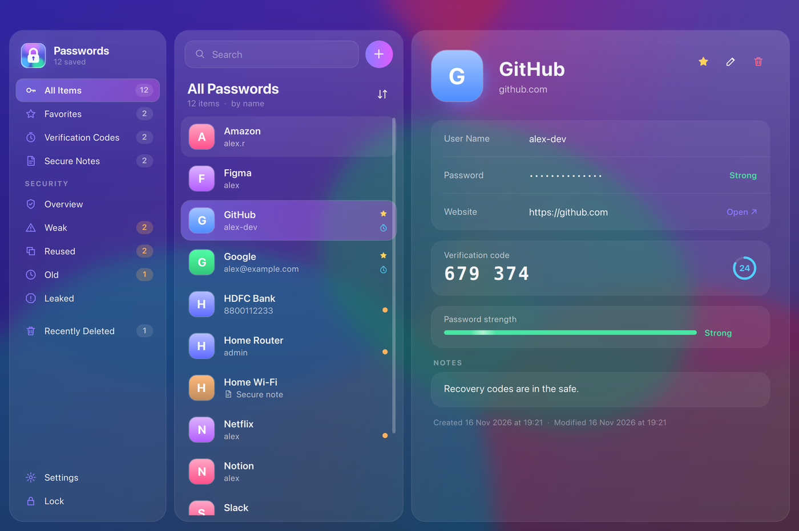
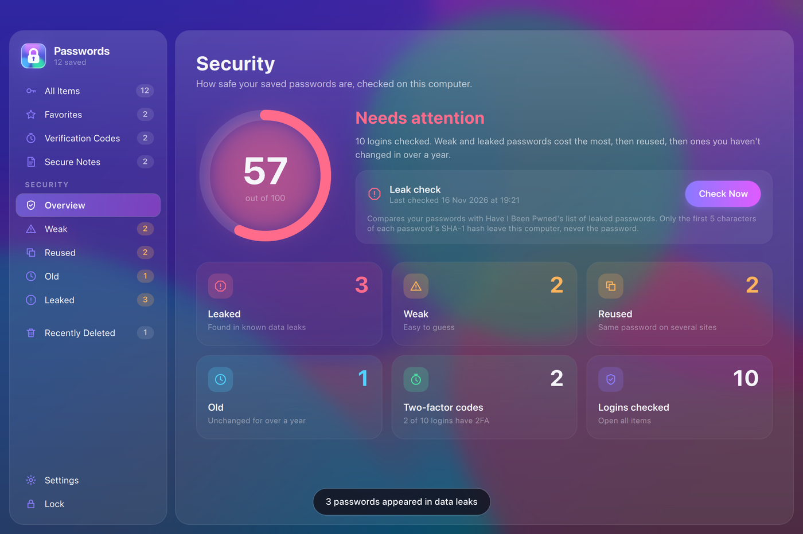
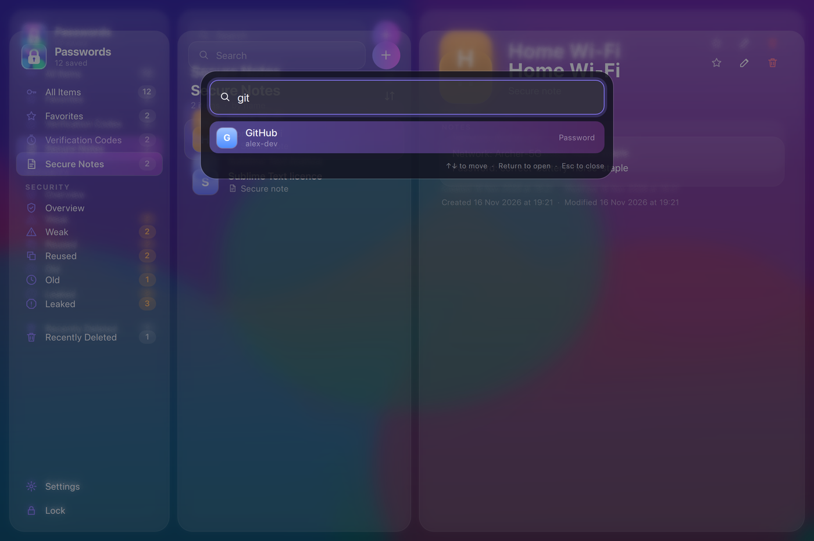
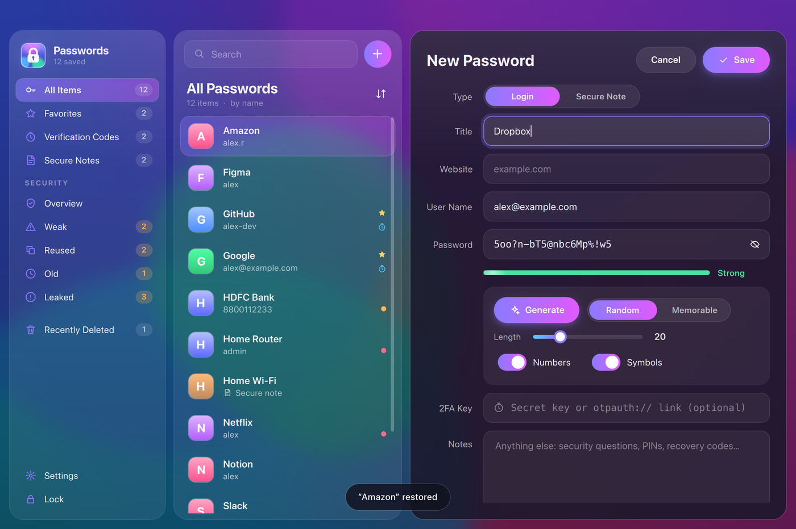
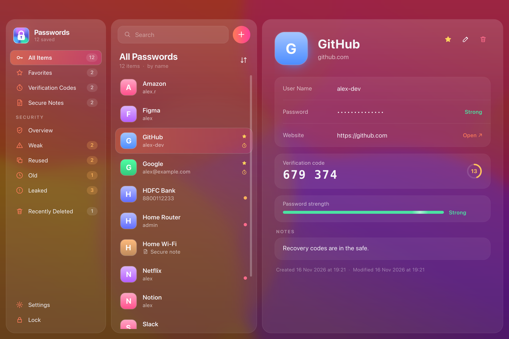
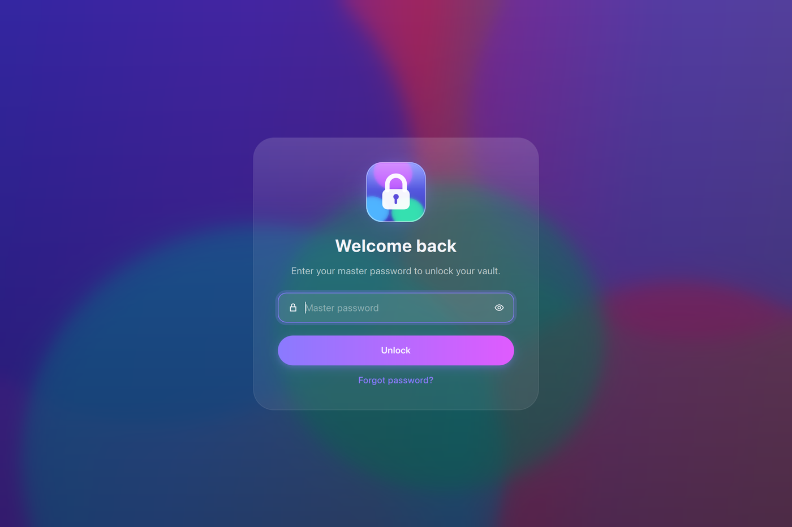

<h1 align="center">
✨🔐 <span style="background: linear-gradient(90deg,#00C9FF,#92FE9D); -webkit-background-clip: text; -webkit-text-fill-color: transparent;">Password Manager MARK IV</span> 🔐✨
</h1>

<p align="center">
  
  
  
  
  
  
</p>

<p align="center">
  🧠 <b>Secured. Simple. Smart.</b>
  <br>
  A lightweight password manager using <b>Fernet Encryption</b> & <b>MySQL</b> for secure local storage,
  <br>
  with a liquid-glass Qt interface 🪟 that runs on <b>macOS, Linux and Windows</b>.
</p>

---

## 🚀 Features

✅ A **liquid-glass interface** (Qt Quick): frosted panels over a flowing five-colour gradient, spring animations, four colour themes (Aurora, Ocean, Sunset, Forest) and a *Reduce motion* switch
✅ Titles, websites, user names and **encrypted notes**; letter avatars; **Favorites**; instant **search**
✅ **Password generator**: random (8–64 characters, numbers/symbols) or memorable (`kabomi-Tefuna-ri7oke`), with a strength meter
✅ **Security overview**: a score out of 100 plus Weak, Reused, Old (over a year) and Leaked lists, each explained on the entry
✅ **Leak check** against Have I Been Pwned; only the first 5 characters of each password's SHA-1 hash leave your computer
✅ **Email security alerts** (optional): lockouts after wrong master passwords, recovery-key use, master password or recovery key changes, and leaked passwords, sent from your own Gmail, iCloud Mail or Yahoo Mail address to itself
✅ **Two-factor codes**: store a site's 2FA key and see the live 6-digit code with a countdown ring (RFC 6238)
✅ **Password history**: the last 10 passwords of each entry are kept when you change it
✅ **Secure notes** for PINs, licence keys and recovery codes
✅ **Command palette** (`⌘K` / `Ctrl+K`) to find anything or run any action
✅ **Encrypted backups** (`.pmbackup`) sealed with a backup password, plus **Undo** after deleting
✅ **Passwords are never shown**: click the dots to copy one, and copied passwords are **cleared from the clipboard** after 30 s; click any other field to copy it
✅ **Recently Deleted**: deleted passwords can be restored for 30 days
✅ **Auto-lock** after 5 minutes idle (configurable), and `⌘L` / `Ctrl+L` to lock right away
✅ Unlocking and saving run in the background, so the interface never freezes
✅ **Import** CSV from Chrome, Safari, Firefox, Edge, Bitwarden or 1Password (2FA keys included); **export** to CSV
✅ Every entry (title, website, user name, password, notes) encrypted with **Fernet** (AES-128-CBC + HMAC-SHA256)
✅ Encryption key protected by your **master password** (scrypt), never stored in plaintext
✅ **Recovery key** to reset a forgotten master password, without weakening the encryption
✅ MySQL login protected by **GnuPG** (AES-256), with a dedicated least-privilege MySQL user
✅ Brute-force protection: growing lockout after 5 wrong master passwords, and **no data is ever deleted**
✅ **One-click installers** for macOS, Linux and Windows
✅ 100% local: no cloud, no telemetry (email alerts are off unless you turn them on)

---

## 📦 Install

| OS | One click | Or from a terminal |
|---|---|---|
| 🍎 **macOS** 11+ | Double-click **`install.command`** | `./install.sh` |
| 🐧 **Linux** (Ubuntu, Debian, Fedora, Arch) | – | `./install.sh` |
| 🪟 **Windows** 10/11 | Double-click **`install.bat`** | `powershell -ExecutionPolicy Bypass -File install.ps1` |

Without cloning the repo (macOS/Linux):

```bash
curl -fsSL https://raw.githubusercontent.com/TGvenomYT/password-manager/main/install.sh | bash
```

The installer:

1. Installs **Python 3**, **GnuPG** and **MySQL** if they're missing (Homebrew on macOS; apt, dnf or pacman on Linux; winget on Windows) and starts MySQL.
2. Installs the app into its own virtual environment and **builds a native app for your machine** with PyInstaller: `Password Manager.app` on macOS, `PasswordManager.exe` on Windows, a `PasswordManager` binary on Linux. If that build fails, the app runs from the Python environment instead (set `PM_NO_BINARY=1` to skip the build).
3. Creates the `password_manager` database and a MySQL user `pm_app` with a random password, which can only access that database. The app never logs in as `root`.
4. Asks you for a **GPG passphrase** and uses it to encrypt that MySQL password on disk.
5. Adds a launcher: `~/Applications/Password Manager.app` on macOS, an applications-menu entry on Linux, Start Menu and Desktop shortcuts on Windows.

On first launch the app asks you to create your **master password**.

> **macOS note:** if Finder says `install.command` "can't be opened", right-click it and choose **Open**, or run `./install.sh` in Terminal.

Other installer options: `--reconfigure` (redo the database/GPG setup), `--uninstall` (remove the app but keep your vault), `--no-launch`. On Windows: `-Reconfigure`, `-Uninstall`, `-NoLaunch`.

**Uninstall on Windows:** double-click **`uninstall.bat`**. It removes the app and its shortcuts and keeps your vault and settings, so `install.bat` picks up where you left off. `uninstall.bat /all` (run as administrator) also erases your settings and vault, after you type `ERASE`.

---

## 🔑 How It Works

You use two secrets:

| Secret | Protects | When you type it |
|---|---|---|
| **GPG passphrase** | The MySQL password, stored as `db-credential.gpg` | At launch. gpg-agent usually remembers it for about 10 minutes, depending on its version and settings |
| **Master password** | Your vault: the key that decrypts your passwords | Every time you open the vault |
| **Recovery key** | A second way to unwrap the same data key, shown once for you to write down | Only if you forget the master password |

```
master password ──scrypt (128 MiB, random salt)──▶ key-encryption key
                                                       │ unwraps
                                                       ▼
vault_meta.wrapped_key ──────────────────────────▶ data key (Fernet) ◀── recovery key (HKDF), via
                                                       │                 vault_meta.recovery_wrapped_key
                                                       │ decrypts
                                                       ▼
passwords.password ──────────────────────────────▶ your passwords
```

- The **data key** is random and only stored *wrapped* (encrypted) with a key derived from your master password. Someone who copies the whole database can't decrypt anything without the master password, and each guess costs them a 128 MiB scrypt computation.
- The **recovery key** is 25 random characters (125 bits) that wrap the same data key a second time. It's far too long to guess, and wrong recovery keys count towards the same lockout as wrong master passwords.
- After **5 wrong master passwords** the vault locks for 30 seconds, then 60, 120, and so on up to 1 hour. The counter is stored in the database, so restarting the app doesn't reset it.
- Files are stored per user, with owner-only permissions:
  - macOS: `~/Library/Application Support/PasswordManager/`
  - Linux: `~/.config/password-manager/`
  - Windows: `%APPDATA%\PasswordManager\`

### 🔑 Forgot your master password?

When you create the vault, the app shows a **recovery key** like `GT7ZY-M5DV4-BQJAG-3N88J-V4YRC`. Write it down, or save it as a file somewhere other than this computer. Vaults made before recovery keys existed get the same prompt after their next unlock. You can make a new key any time from **New recovery key** on the menu; it replaces the old one.

To use it: on the unlock screen, click **Forgot your master password?**, enter the recovery key and a new master password. The app then offers you a fresh recovery key.

⚠️ If you lose **both** the master password and the recovery key, the vault can't be decrypted. Nobody, including the developer, can get it back.

### 📧 Email alerts

**Settings → Alerts** sets them up. Enter your Gmail, iCloud Mail or Yahoo Mail address and an **app password** for it: a separate password your email account makes for apps (for Gmail, turn on 2-Step Verification, then make one at [myaccount.google.com/apppasswords](https://myaccount.google.com/apppasswords)). The app sends a test email, and turns alerts on once it's gone through.

You then get an email when:

- someone enters the wrong master password (or recovery key) enough times to start a lockout
- the recovery key is used to set a new master password
- the master password changes, or a new recovery key is made
- a leak check finds leaked passwords

Alerts only ever go from your address to that same address. They never contain passwords or the names of your accounts. The app password is kept in the system password store (macOS Keychain, Windows Credential Manager, or the Secret Service on Linux), never in a file. Lockout and leak alerts are sent at most once every 10 minutes. **Remove…** turns alerts off and deletes the app password from the computer.

---

## ⬆️ Upgrading from v3.x

Run the installer again. On your first unlock, version 4 moves each saved entry into a single encrypted record (until now the user name was stored readable) and adds favourites, notes and Recently Deleted. It happens once, in one transaction. Older versions of the app can't read an upgraded vault, so update every computer that shares the database.

## ⬆️ Upgrading from v2.x

Run the installer. On your first unlock, the app automatically upgrades an old database:

- Your **existing master password keeps working**.
- The old plaintext key in the `locker` table is replaced. A new data key is generated, every saved password is re-encrypted with it, the new key is wrapped with your master password, and the `locker` table is deleted. This all happens in one transaction, so it either completes fully or changes nothing.
- The old `passwd.txt.gpg` and `root` login are no longer used. Setup asks for the MySQL `root` password **once**, to create the `pm_app` user.

<details>
<summary><b>What was wrong with the old key handling (fixed in 3.0)</b></summary>

- The Fernet key was stored **in plaintext** in the `locker` table, next to the encrypted passwords. Anyone with database access could decrypt everything; the master password was only a check in the GUI.
- The key and the master password hash were written as **two separate half-empty rows**. The "does a key exist?" check (`SELECT … LIMIT 1`) matched either row, and other versions of the code assumed a single row.
- `password VARCHAR(255)` was too short for the encrypted form of passwords longer than about 127 characters, so saving them failed.
- 5 wrong master passwords ran `DROP DATABASE`, deleting the whole vault, but the counter reset on restart, so it only ever hurt the real user.
- `auth_plugin='mysql_native_password'` fails on MySQL 9, which removed that plugin.
- With bcrypt 5, master passwords over 72 bytes crashed the app.
</details>

---

## 🛠️ Manual setup (advanced)

Requirements: Python 3.9+, GnuPG 2.2+, and MySQL 8+ or MariaDB 10.5+. The interface uses Qt 6 (PySide6, installed by pip).

```bash
python3 -m venv venv && . venv/bin/activate
pip install .
python -m password_manager setup              # add --admin-command "sudo mysql" on Ubuntu/Debian
python -m password_manager                    # launch

# optional: build a standalone app for this machine
pip install "pyinstaller>=6.11" && pyinstaller --noconfirm packaging/PasswordManager.spec
dist/PasswordManager --self-test              # macOS: "dist/Password Manager.app/Contents/MacOS/PasswordManager"
```

`setup` options: `--host`, `--port`, `--socket`, `--database`, `--app-user`, `--admin-user`, `--admin-command`, `--reconfigure`.

## 🧯 Troubleshooting

| Problem | Fix |
|---|---|
| "Could not connect to MySQL" | Start the server: `brew services start mysql` / `sudo systemctl start mysql` / the *PasswordManagerMySQL* service |
| Forgot the GPG passphrase | `./install.sh --reconfigure` (your vault is unaffected) |
| Forgot the master password | **Forgot your master password?** on the unlock screen, with your recovery key |
| gpg seems stuck | `gpgconf --kill gpg-agent` |
| Email alerts: "didn't accept that app password" | Make a new app password (Gmail needs 2-Step Verification turned on), then **Remove…** and set up alerts again in **Settings → Alerts** |
| Something else | Check `password-manager.log` in the settings folder above |

## 🧪 Development

```bash
pip install -e ".[test]"
pytest                                                   # unit tests
PM_TEST_MYSQL="root:password@127.0.0.1:3306" pytest     # plus database tests (uses throwaway databases)
```

---

## 🎬 Screenshots

<p align="center">
  
</p>
<p align="center">
  
  
</p>
<p align="center">
  
  
</p>
<p align="center">
  
</p>

### ⌨️ Keyboard shortcuts

| Action | macOS | Windows / Linux |
|---|---|---|
| Command palette | `⌘K` | `Ctrl+K` |
| New password (a note in Secure Notes) | `⌘N` | `Ctrl+N` |
| Search | `⌘F` | `Ctrl+F` |
| Copy the selected password | `⌘C` (in the list) | `Ctrl+C` |
| Move between passwords | `↑` / `↓` | `↑` / `↓` |
| Edit / move to Recently Deleted | `Return` / `Delete` | `Return` / `Delete` |
| Save / cancel in the editor | `⌘S` / `Esc` | `Ctrl+S` / `Esc` |
| Lock | `⌘L` | `Ctrl+L` |
| Settings | `⌘,` | `Ctrl+,` |

---

## 🌈 About the Project

> **MARK IV** is designed for users who value **simplicity and privacy**.
> Built with 💙 and Python, it keeps your credentials safe, right on your device.

---

## 💬 Connect With Me

<p align="center">
  <a href="https://github.com/TGvenomYT">
    
  </a>
  <a href="https://Discord.com/users/tgvenom0441">
     
  </a>
  <a href="mailto:rajicbe1969@gmail.com">
    
  </a>
</p>
